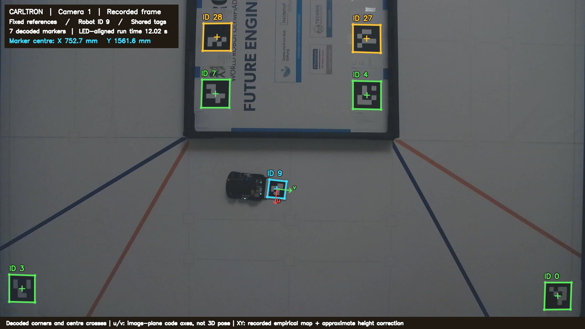

# Carltron Future Engineers 2026

This is the Future Engineers project repository by Team Carltron for the 2026 World Robot Olympiad International Final in Puerto Rico. Our starting point is the robot we used at the German final, where we achieved second place and qualified for the International Final. It uses front-wheel steering, rear-wheel drive, optical odometry, a scanning LiDAR, and an upward-facing wide-angle color camera.

For the international competition, we want to make the robot faster while keeping it reliable. Before changing the drivetrain and navigation, we built Optical Motion Tracking to compare the robot's position estimates with a separate measurement. Since then, we have fitted a replacement motor, added sensor recording and tested different sensor mounts and controllers. The [testing and development pages](docs/testing/README.md) describe that work. The competition source here is still the version from the German final, with the newer controllers being tested separately.

## Repository contents

| Location | Contents |
| --- | --- |
| [src/prod/robot_core](src/prod/robot_core/) | Production perception, localization, navigation, camera, motor, steering, and hardware PWM code. |
| [src/tests](src/tests/) | Hardware entry point, calibration suites, synthetic color-classifier checks, log analysis, and waypoint tools. |
| [docs/architecture.md](docs/architecture.md) | Sensor data flow and responsibilities of the software modules. |
| [docs/setup.md](docs/setup.md) | Software environment, hardware prerequisites, and startup procedure. |
| [docs/hardware.md](docs/hardware.md) | Baseline hardware, sensor arrangement and actuator configuration. |
| [docs/operations](docs/operations/) | Field operation, command-line flags, calibration procedures, and troubleshooting. |
| [docs/tracking](docs/tracking/) | Optical motion tracking system, validation results, tutorial and printable targets. |
| [docs/testing](docs/testing/) | Sensor and drivetrain tests, the approaches we tried and the results. |
| [tools/tracking](tools/tracking/) | Optical motion tracking tools for PC-side camera control, marker analysis, field registration and run replay. |
| [tools/experiments](tools/experiments/) | Selected measurement data and the script used to generate the figures. |
| [models](models/) | Location for mechanical models and manufacturing files. |
| [schemes](schemes/) | Location for circuit diagrams and board documentation. |
| [t-photos](t-photos/) and [v-photos](v-photos/) | Locations for team and vehicle photographs. |
| [video](video/) | Location for links and descriptions of autonomous driving demonstrations. |

The production entry point retains its existing filename, `src/tests/perception_web_test.py`, even though it is the normal hardware runner rather than a unit test. Historical controller experiments and duplicate driver copies are not included in this baseline. The runtime imports the production package from `src/prod`, keeping the software layout consistent with the existing robot installation.

## Sensors and electronics

We run the robot on a Raspberry Pi 5 with Ubuntu 24.04 and Python 3.12. It handles perception, navigation and actuator control without a separate motor-control microcontroller. Our custom main board connects the power supply and actuator interfaces, including a DRV8871 module for the brushed drive motor. We use ROS 2 Jazzy to receive LiDAR scans on `/scan` as `sensor_msgs/LaserScan` messages. The rest of the program exchanges state directly in Python.

For localisation, we need frequent updates while driving and a position that stays useful over several laps. The SparkFun Qwiic Optical Tracking Odometry Sensor, or OTOS, looks at the floor and reports relative position, heading and velocity. We use it to follow short movements, then correct the accumulating drift with wall measurements from the RPLIDAR S3. The motor encoder provides feedback for drive-speed control.

LiDAR tells us where an obstacle is, but we also need its colour to choose the passing side. For this we use a Waveshare IMX219-200 camera with an Arducam LN010 M12 fisheye lens. It faces upwards from below the wall tops and captures the surroundings in a circular image. Once LiDAR finds an obstacle, we use its direction to select the camera patch for colour classification. The competition program uses the camera for this task. Our later camera-localisation trials are separate experiments.

## Localisation and navigation

We describe the robot's pose as its position and heading in field coordinates, using metres and degrees. Since the LiDAR rotates while the robot moves, the points in one scan are measured from slightly different positions. We keep a timestamped OTOS history and interpolate it at the time of each beam to compensate for that movement.

We then compare the observed walls with the field model and correct the relationship between local odometry and field coordinates. OTOS continues supplying motion updates between scans. Before using a wall match, we check its confidence and age and limit the correction size to avoid moving the estimate on a poor match.

For obstacles, we also need information to persist beyond a single scan. We store detections in a map of field-related slots and use the first obstacle lap to confirm their positions and colors. Confirmed passing decisions can then be locked for later laps instead of being reconsidered from every new observation. Navigation builds waypoints from this map and steers toward a lookahead target. Speed caps, observation holds and recovery states handle situations where the available information does not yet support continuing normally.

The Open Challenge uses the same localisation and control without obstacle passing. During the first lap, we classify the corridor geometry so later laps can use a shorter inner route. The Obstacle Challenge adds the obstacle map, colour confirmation and departure from the parking area, followed by parking after the laps. The included parking sequence is still the German-final version. We haven't yet included the international parallel-parking replacement.

## Motor and steering control

Navigation requests speed and steering, which [`drivebase.py`](src/prod/robot_core/drivebase.py) converts into motor and servo outputs. We use a calibrated duty-to-speed profile to choose an initial motor output, then correct it with encoder feedback. The configuration includes wheel diameter, encoder conversion, drive reduction, steering trim, acceleration, braking and low-speed handling.

Keeping actuator control on the Pi also meant getting hardware PWM working on our Ubuntu installation. We use [`hw_pwm.py`](src/prod/robot_core/hw_pwm.py) to access it through Linux sysfs. The channels handle steering, an LED output and both drive directions. We cache file descriptors and skip duplicate writes to reduce repeated work, and record write timings when investigating delays. The channel mapping is specific to our board and Pi setup.

For the faster drivetrain, we need to compare the requested speed with the speed actually reached. The motor might already be at its output limit, or navigation might be applying a lower cap. We record both commands and measured motion so we can see which happened.

## Software setup and startup

We normally start the program through `midcmbfol.service` on the robot. For manual testing on the prepared Pi, stop that service, source ROS and activate the existing robot virtual environment, then run the entry point from the repository root:

```bash
sudo systemctl stop midcmbfol.service
source /opt/ros/jazzy/setup.bash
python3 src/tests/perception_web_test.py
```

The program uses the physical start/deadman input by default and can actuate the robot. Before testing on the ground, check the start input and shutdown path with the wheels lifted, and make sure no second process is controlling the same hardware.

The [setup guide](docs/setup.md) covers Python dependencies, ROS, libcamera and device access. The [runbook](docs/operations/runbook.md) covers the installed service and radio-mode helpers. The service and wrapper files are not included in this revision, so starting an already prepared robot and building a fresh Pi installation are not yet equivalent procedures.

The German-final program requests OTOS polling at 150 Hz, command application to DriveBase at 75 Hz and the inner DriveBase controller at 100 Hz. These are scheduling targets, not guaranteed real-time rates. The [flag guide](docs/operations/main-script-flags.md) explains the command-line settings defined in `robot_core/perception.py`. Each run's manifest records the settings used.

## Diagnostics and testing

We use the web portal to inspect telemetry, the map and camera previews during development. The robot can navigate without it. During fast runs, the extra load of Full WebUI has caused commands to become stale and trigger speed limits. We therefore also have a lighter map and status view, with detailed logs available for analysis afterwards.

Each run can create timestamped CSV logs and a manifest containing its settings. Important files include `drive_debug.csv`, `lidar_scan_debug.csv`, `camera_color_debug.csv` and `obstacle_slot_debug.csv`. Our analysis scripts cover drive timing, LiDAR alignment, colour classification and odometry calibration. We keep the large raw archives outside Git and include selected observations and results from one paired run in the tracking example.

The included test tools cover OTOS calibration, speed calibration, steering-center adjustment, low-speed driving, LED checks, and color-classifier cases. The synthetic color test does not require camera hardware, but it does require NumPy and OpenCV:

```bash
python3 -m src.tests.cammanager_classifier_synthetic
```

Repository checks do not actuate hardware:

```bash
python3 tools/check_repository.py
```

These checks compile Python source without running it, parse JSON configuration, check local documentation links and verify the README length. The validation workflow runs them as well. They catch errors in the repository, while driving performance still needs physical testing.

## Optical Motion Tracking

To measure localisation accuracy, we needed a reference separate from the robot's own sensors. We built Optical Motion Tracking using two cameras, fixed field markers and an 85 mm ArUco marker on a 100 mm plate behind the robot. We use the images to calculate its position and heading and compare them with the onboard logs.



We map each camera view into measured field coordinates and account for perspective, lens distortion and marker height. Only stationary references are used to fit the spatial mapping. The first comparison was recorded without sending positions to the robot. We later added an API for test initialisation, repositioning and safety checks. During the experimental fusion laps, moving optical positions don't correct navigation, and the competition program runs without the tracking system.

At one stationary placement that wasn't used to fit the map, the cameras differed by about 1.06 mm. The placement itself had about 1.5 mm uncertainty. Moving comparisons still showed larger differences, with timing a significant unresolved part of the error. The [tracking overview](docs/tracking/README.md) explains the setup and first results. The [usage guide](docs/tracking/USAGE.md) includes analysis commands and printable targets.

## Testing and development

The faster drivetrain led us to two different OTOS problems. In a four-leg encoder on/off test, we got about 93–99 Hz with encoder acquisition on and about 150 Hz with it off. The native I²C calls stayed short in both cases. Even at the restored read rate, the sensor could still miss movement. We then compared a replacement sensor at different heights and got substantially better straight-line measurements with its window 20 mm above the floor than at 10 or 14 mm.

The [motor and drivetrain tests](docs/testing/drivetrain.md) cover starting, holding a low speed and braking. We also tried [camera localisation](docs/testing/camera-localisation.md), including learned position models that didn't meet our improvement criteria. The [localisation and driving tests](docs/testing/localisation-development.md) describe the fusion prototype and its results over several laps, including partial runs and the recovery behaviour that still needs physical testing. The pages include selected plots and measurement data.

## Repository status

This revision contains the German-final program, its diagnostic tools, the first tracking analysis and the later test documentation. We haven't yet included an international parallel-parking implementation or a completed MATLAB/Simulink vehicle model. The Pololu motor and newer controllers have been tested separately, with their results documented here. They haven't been integrated into this competition program, and reliable competition driving at 2 m/s hasn't been demonstrated.

Mechanical CAD, main-board and wiring files, the full vehicle and team photograph set, autonomous challenge video links and the complete boot installation are not included. The linked source, operating guides and measurement example describe the material currently available.
