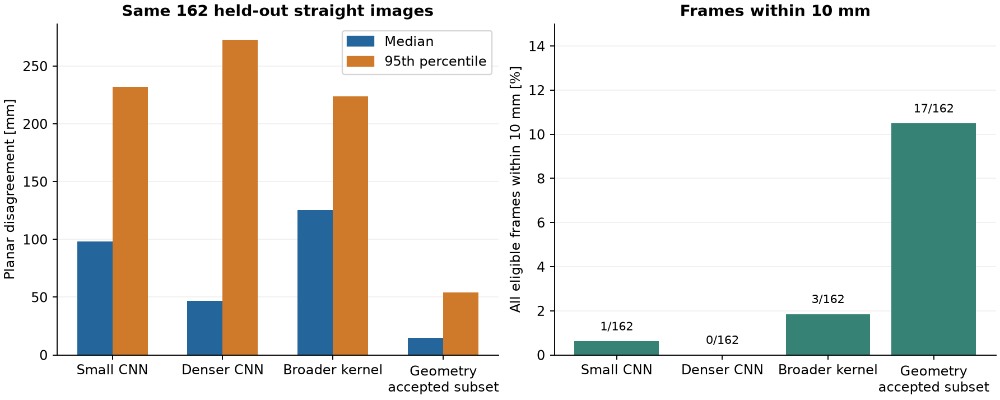

# Camera localisation

We already use our upward-facing fisheye camera to detect obstacle colours. Since it can also see the field walls around the robot, we wanted to find out whether we could use those images for localisation. This would give us another position measurement without having to fit another sensor.

## Wall detection

The field gives us known geometry to work with. We looked at wall-to-floor edges, wall tops and corners, then used the camera calibration to compare them with the field model. The surrounding room might make localisation easier at home, but it would be different at the competition. We therefore wanted to base the method on the field itself.

For inspecting the images, we unwrapped the circular view into a polar strip. This made the corners and wall edges much easier to see. It uses the same pixels, but arranges them by direction around the robot, which was useful for checking detections and later for training a small model. We also kept the detected features separate from the position calculation. A projected wall outline can look convincing even when the program hasn't accepted a camera position for that frame.

We could get useful position estimates from some images, but getting them consistently was harder. Some wall edges looked clear to us and still weren't detected. Other strong brightness changes were incorrectly treated as wall boundaries. We tried looking at edge strength, continuity, several wall features together and their agreement with the map. On a test set of 162 straight-section images, the geometric method accepted 47 frames. Its median planar difference from tracking was about 15 mm on those frames, but it left most of the images without a measurement.

## Camera resolution

We also compared binned and full-resolution images with the robot stationary at the same nominal position. We looked at the original circular image, a forward-facing polar view and the full panorama. The saved examples used 1640 × 1232 and 3280 × 2464 sensor modes at about 8 ms exposure. They arrived at approximately 30 and 20 fps respectively, with output crops different from the sensor dimensions. These were the settings of those samples, rather than a test of every mode the camera supports.

The full-resolution image showed more detail. Whether that would give us a better position during driving was still open, since the lower frame rate also means more movement between images. We kept this as an image comparison and didn't count it as a measured localisation improvement. The [camera mode data](../../tools/experiments/data/camera-modes.json) lists the settings used.

## Machine learning tests

Another approach was to train a model directly from images and the positions measured by Optical Motion Tracking. That would let us try a learned position estimate without manually marking wall edges. Since the field repeats after a 90° rotation, we started with a smaller task. Given the section and driving direction, the model estimated the position along the straight and the distance from its outer wall. It didn't have to find the robot globally or estimate its heading.

We used the polar strip as input and masked out irrelevant surroundings and the area hidden by the robot. The mask was fixed, so its shape couldn't give away the target position. We also removed visible marker identities. We compared a lookup based on similar images, PCA with kernel regression, and a small convolutional neural network, or CNN. To keep neighbouring frames from making the test too easy, we separated whole spatial regions or visits into training and test groups.

For the first attempt, we used a small set with a reduced frame rate. We then increased the image rate and included more drives and corners in a broader experiment. In total, the larger cache contained 5,770 qualified images. Many came from neighbouring moments on repeated paths, so the number of different positions was much smaller than the image count might suggest.

| Method selected using validation data | Median / P95 planar difference | Frames within 10 mm, of the same 162 eligible images |
| --- | --- | --- |
| Original small CNN | 98 / 232 mm | 1 |
| Denser straight-section CNN | 47 / 273 mm | 0 |
| Broader full-rate kernel model | 126 / 224 mm | 3 |
| Geometric observations, accepted subset | 15 / 54 mm on 47 accepted frames | 17 |

The geometric method had extra information to guide its search and could reject a frame, while the learned models returned a position for all 162 images. Their error figures therefore need to be read together with availability. In the within-10-mm column, we count all 162 images, including the ones rejected by the geometric method. On the broader model's own 976-image test set, its median/P95 difference was about 105/340 mm. The [comparison data](../../tools/experiments/data/camera-learning.json) contains the results on the common test images.

Using more images reduced the typical error in the denser training test, but the large errors remained. None of the completed models met the combined improvement criteria we had set for the trial. We therefore decided to continue with the geometric methods instead of replacing localisation with image regression. The main problem was still getting a reliable measurement from enough of the images during a drive.
