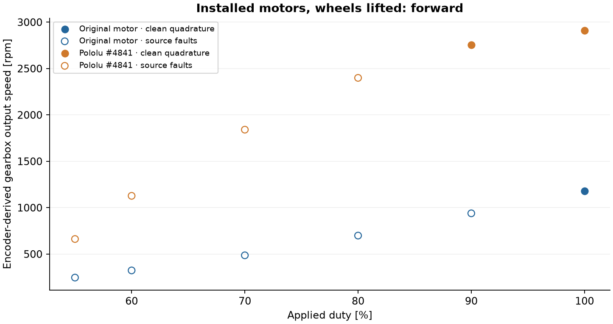
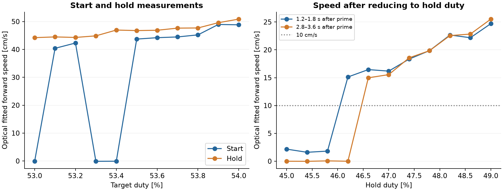
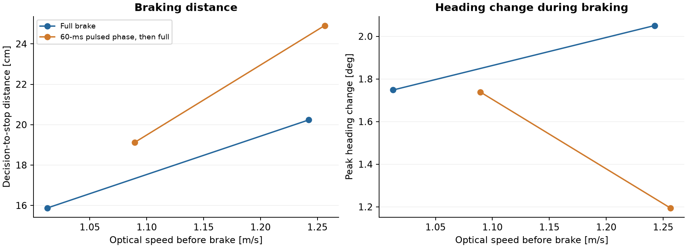

# Motor and drivetrain tests

Before replacing the motor, we wanted a useful comparison with the drivetrain we had driven at the German final. Higher top speed was one reason for the change, but we also needed to know what would happen at low speed. Starting from a parking position and making small corrections would become difficult if the new motor only worked well once the robot was already moving quickly.

We first measured the original motor in coarse duty steps, then filled in the range in one-percentage-point steps before fitting the Pololu #4841. Optical Motion Tracking gave us a separate measurement of distance and speed. We evaluated the same part of each drive instead of picking its fastest samples. Of the 51 forward observations, 50 met our criteria for a sufficiently steady measurement window. The batteries discharged during the tests and we didn't record their voltage, so the resulting curve includes that change in conditions.

## Motor and encoder checks

For the first motor checks, we lifted the wheels and ran a sequence of duty values with the original motor. We then repeated it with the replacement. We also tested the replacement while it was only connected by its cable, before installing it. This let us check its direction and encoder first, then look at how fitting it into the drivetrain affected the result.

The new encoder reports a different number of counts per revolution, so we had to change the conversion before comparing shaft speeds. We also kept track of invalid transitions and missing events. The conversion for the original motor comes from our earlier calibration and hasn't been independently verified against its physical encoder resolution.

The filled points come from windows with clean quadrature signals. Hollow points have recorded transition or sequence errors, so their converted speeds are less trustworthy. The replacement reaches a substantially higher gearbox speed with the wheels lifted. To find out how much of that we can use on the field, we still need the ground tests.

These runs didn't measure torque, efficiency or supply voltage. We also kept the existing 3.3 V encoder supply, which is below the replacement encoder's specified minimum. It decoded successfully in some windows, but that alone doesn't establish that the supply is adequate in all conditions. The [motor comparison data](../../tools/experiments/data/raised-motors.json) includes the configuration and signal-quality results.

## Starting duty and hold duty

In the first ground sweep, the replacement didn't produce relevant vehicle movement at 50–53% duty and started moving clearly at 54%. We then measured the transition more closely. For each value, we tried starting from rest and compared it with reducing to that value after an initial drive phase. We call the latter the hold test.

At 53.0%, the start test stayed essentially still, while the hold test moved at about 0.44 m/s during the evaluation window. Some of the intermediate start values also failed to get the robot moving. This meant we couldn't describe starting behaviour with one exact duty threshold.

The left plot shows the 22 start and hold tests from 53.0 to 54.0% in 0.1-point steps. We then tried hold values from 45.0 to 49.0% in 0.4-point steps, with an initial drive phase of about 0.3 s. These are shown on the right. We compare an early and a late window because a low speed just after reducing duty can also mean the robot is slowing to a stop. At 46.2%, it falls from about 0.15 m/s to approximately zero. At 46.6%, it stays near 0.15 m/s. The tests show what happened under these battery and load conditions, and would need repeating before choosing a dependable minimum speed.

To try to get below that range, we tested alternating drive with coasting or braking. At an 18 cm/s target, Optical Motion Tracking measured an average of about 22.2 cm/s for drive/coast and 18.0 cm/s for drive/brake. We could also get lower average speeds, but the motion wasn't necessarily steady. At the 10 cm/s target, only about 4% of evaluated optical samples in the brake test were within the target band. We therefore haven't adopted this as a reliable creep controller. The [comparison data](../../tools/experiments/data/drive-coast-brake.json) includes OTOS, encoder and tracking measurements.

## Battery comparison

Our speed controller uses the measured duty-to-speed profile to choose an initial output, then corrects it from speed feedback. As the battery discharges, it can need more correction than we've allowed. We saw this even at relatively modest speeds, so we repeated the same target-speed test with a fresh battery and kept the speed and mounting profiles unchanged.

With the fresh battery, all six legs returned successfully. The 0.7 and 0.9 m/s tests gave us four steady evaluation windows. The two 1.1 m/s legs were too short to meet the same rule, so we didn't substitute shorter windows into that comparison. The median absolute difference in longitudinal endpoint displacement was 3.6 mm, while the lateral differences were about 15–30 mm. These are local displacement results, not whole-field accuracy measurements.

We recorded whether the battery had been changed, but didn't measure voltage or exact charge throughout the run. There isn't enough information to turn the reported charge percentages into a linear correction. The [paired results](../../tools/experiments/data/target-speed.json) show both battery conditions and the available evaluation windows.

## Braking tests

During the faster tests, the robot sometimes travelled much further than expected after braking. We initially looked for a software or sensor problem, but then found a loose wheel mounting. After tightening it, we repeated the measurements and kept the earlier runs separate.

We also observed the rear wheels locking during hard braking, with the robot sliding and turning as it stopped. Even with the wheel mounting fixed, this could produce a large heading change. In that situation, wheel rotation no longer tells us how far the vehicle is moving, which makes the optical comparison particularly useful.

We tried a small braking comparison at 70 and 75% drive duty. One version applied full braking immediately. The other started with a 60 ms pulsed phase and then applied full braking. We collected seven trials, with two per group except for one pulsed trial at 75%.

The pulsed version increased the median distance from the brake decision to the stop from about 15.9 to 19.1 cm at the lower duty, and from 20.2 to 24.9 cm at the higher duty. The initial speeds were similar but not identical. We didn't find a useful stopping improvement, so we continued with full braking for these tests. The pulse sequence didn't detect wheel slip and wasn't an ABS controller.

The new motor gives us more speed, but using it also depends on localisation and control keeping up. We need to measure the speed correctly, reach the requested value and still have room for the next curve or stop. We investigated those parts in the [OTOS tests](otos.md) and [localisation and driving tests](localisation-development.md).
