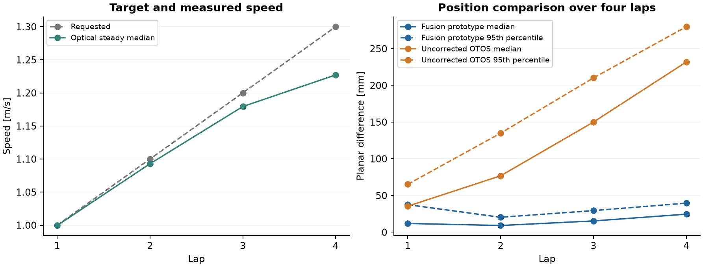

# Localisation and driving tests

Our existing localisation already uses OTOS for frequent motion updates and LiDAR to correct drift against the field walls. After the sensor and drivetrain tests, we wanted to see how much more we could get from that combination. We started with the recorded data, then used an experimental fusion controller for driving tests. This is still development work and hasn't replaced the competition program.

## Sensor fusion

The two sensors complement each other. OTOS follows movement between scans, while LiDAR can relate the robot to the known walls. Timing makes this more involved than simply averaging their positions. The LiDAR rotates while the robot is moving, and its processed result arrives after the measurements were taken. We keep a short history so we can compensate for motion during the scan, apply a correction at the right time and carry the later movement forward from there.

We compared using the velocity reported by OTOS with calculating movement from successive position readings. Both come from the same device, so we don't treat them as two independent measurements. We also keep angular motion separate from optical translation. If the sensor loses track of the floor, its gyro may still be useful.

For the curve tests, we chose position increments, angular motion and motion-compensated LiDAR wall matches. We recorded raw acceleration as well, but haven't established a benefit from integrating it into position. Encoder, BNO085 and onboard camera measurements aren't used by this version.

Optical Motion Tracking gives us the stationary start position and supervises the drive. While moving, the controller calculates its navigation position from the onboard sensors. We then compare that result with tracking afterwards. The tests still depend on tracking for initialisation and safety, even though it doesn't continuously correct the navigation estimate.

## OTOS calibration

We also looked at whether a better OTOS calibration could reduce the remaining error. We tried a constant distance scale, a small angle correction and an adjustment to the sensor's offset from the axle. We compared the models on another recorded run because a good fit to one route could simply compensate for its timing or camera-registration error. We had already inspected these recordings during development, so this wasn't a fully independent model-selection test.

We kept the version using position increments and LiDAR corrections without the extra fitted scale and angle model. There also wasn't enough variety in these runs to justify a more general nonlinear correction. Most of the driving was at one main speed and in one turning direction. The [model comparison](../../tools/experiments/data/fusion-development.json) lists the versions we tried and the settings we selected.

## Lap tests

In the four-lap test shown above, we requested one lap each at speeds from 1.0 to 1.3 m/s. The robot completed all four. On the final lap, Optical Motion Tracking measured a steady median of about 1.23 m/s, with the controller at its 75% PWM limit for approximately 97% of the settled interval. We therefore hadn't actually reached the 1.3 m/s target, and couldn't use that setting alone to describe the speed of the test.

Across the run, the median planar difference between fusion and the fixed optical reference was 13.4 mm, with a 95th percentile of 35.8 mm at the original time alignment. On the last lap, the OTOS-only position differed by a median of about 232 mm, compared with 25 mm for fusion. The plot shows how that developed over all four laps. Timing still has a considerable effect on these numbers, as shown in the [clock synchronisation comparison](measurement-system.md#clock-synchronisation). The many neighbouring frames also shouldn't be counted as independent tests.

In a later run, the robot completed the 1.1, 1.2 and 1.3 m/s laps, then stopped in the first corner of the 1.4 m/s stage. We include the recorded part of that stage, but don't count it as a completed lap. The planned 1.5 m/s stage wasn't attempted. The [lap results](../../tools/experiments/data/curve-pilots.json) identify both runs and separate requested speed, measured speed, position difference and deviation from the commanded path.

## OTOS tracking errors

An earlier 1.4 m/s test stopped when the OTOS position suddenly moved about 22 mm backward while its velocity still indicated forward movement. Over a 200 ms window, the distance from its position readings also differed by about 60 mm from the integrated velocity. The fault status was still 0x00. We wanted to detect this kind of error and get through a short interruption without immediately ending the run.

We added checks comparing position increments, reported velocity and the fused motion estimate already available at that time. If the translation becomes inconsistent, the program temporarily ignores it while continuing to use the gyro and recent LiDAR observations. We allow this for up to 400 ms and require 120 ms of clean increments before using translation normally again. If LiDAR support is missing or the interruption lasts too long, the test still stops.

When we replayed the recorded incident, the new checks ignored the suspect translation for about 145 ms and then recovered. They didn't trigger on two other recordings we checked. We also verified that adding later data didn't change the earlier replay output. This was a useful software test, but the recorded robot had already braked. We still need a physical run to find out how it continues when the recovery actually keeps it moving. The [replay results](../../tools/experiments/data/recovery-replay.json) include that distinction.

## Stopping checks

The stop in the later run had a different cause. None of the translation checks had triggered. Instead, the program predicted where the robot might end up while stopping, both if it continued steering and if it slid straight ahead. With 20 ms added to the age of the control data, the straight-slide prediction brought the robot's centre within about 230 mm of the wall. That was below the 240 mm threshold. The continued-turn prediction still had about 472 mm clearance, and tracking showed the robot close to the intended centreline. The [stop analysis](../../tools/experiments/data/curve-stop.json) records those predictions and the observed position.

We then prepared a change to let these supervised tests continue when recent LiDAR, optical tracking, path alignment and measured yaw all support the turn. In that case, the straight-slide prediction is logged as a warning. The prediction with steering and the checks on actual boundaries, data age and faults remain active. We checked the implementation on recorded states and while stationary. Driving with it at higher speed still needs its own test.

So far, the fusion tests give us a promising way to reduce drift, while also showing problems we need to handle in the complete drive program. We haven't established general millimetre accuracy or reliable curve driving at 2 m/s. Both localisation and the stopping behaviour still need testing over a wider range of conditions.

## Speed and steering control

We also found that switching navigation to fusion wasn't enough on its own. The earlier speed controller still used OTOS-reported velocity and could stop on the same fault that the navigation estimator was trying to bridge. We changed the experimental speed feedback to use the fused velocity already available at that time, and continue recording raw OTOS for comparison.

On straights, we had observed small steering oscillations. We tried looking further ahead where there was enough room before the next corner, together with a short steering filter. This reduced the changes between commands when replayed on the same saved positions. Since the replay can't change the physical trajectory, it doesn't yet tell us how much smoother the robot will drive. We kept acceleration at 1 m/s² in the prepared tests while increasing the target speed separately.
