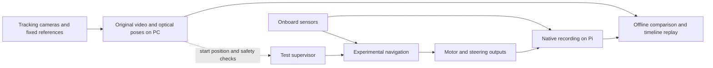
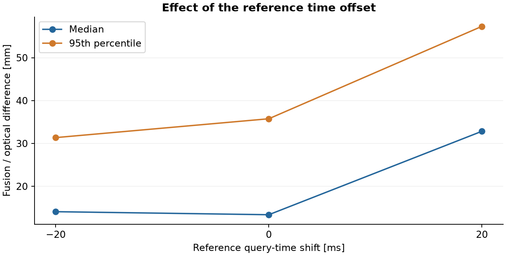

# Test setup and sensor recording

When we started analysing localisation, we already had logs from the robot. They showed the position it calculated and the commands it sent, but we couldn't tell from those alone whether the position was right. If OTOS missed movement, that error could also end up in the fused position and navigation. We needed another way to measure where the robot had actually gone.

We built [Optical Motion Tracking](../tracking/README.md) for that comparison. At first, we only recorded the drive and compared the positions afterwards. Later we added a small API so a test program could ask for the current position and start or stop the camera recordings. This let us use tracking to check endpoints, correct return journeys and supervise faster measurements. In the fusion lap tests, we use it for the starting position and safety checks. The moving position estimate used for navigation still comes from the sensors on the robot.

## Sensor recording

To try different analyses on the same drive, we wanted to keep the sensor inputs as well as the calculated positions. Each sensor passes a copy of its data to the recorder on the Pi. Separate queues allow the data to be written in the background, with a fixed queue size to keep storage delays from consuming unlimited memory.

We save the original bytes, sequence numbers and timestamps where the sensor provides them, together with the times the program received and made the data available. CRC checks detect damaged records, and SHA-256 hashes let us verify backups. At the end of a recording, a summary lists the written records, queue overflows and storage errors. We also keep the data from interrupted tests, along with the reason they stopped.

A file can pass these checks even when the sensor reading itself is wrong or some measurements never reached the recorder. For example, a valid encoder file can still contain gaps in its event sequence. We therefore check those sequences and the delivery rate as well as the files themselves.

During development we recorded OTOS position, velocity and acceleration, LiDAR scans, motor commands, PWM readback and encoder events. Some runs also include BNO085 reports and onboard camera images. We later disabled encoder acquisition, BNO085 and onboard video for the mounting and curve tests. Both tracking cameras continued recording. The configuration is saved with each run, so we can distinguish a sensor that was disabled from one that reported no movement.

## Tracking cameras and position API

Repeatedly opening the cameras caused problems with ownership and the prepared settings. We changed the capture service so it keeps both streams open between recordings. Preview and recording use that service instead of trying to open a camera separately. We also check exposure and focus when preparing a session, since those settings had sometimes reset.

The position API returns the age of the camera frame and the calibration used for the coordinate. That lets the test program reject an old frame or a position from the wrong field registration before using it to control a measurement.

The diagram shows the setup used for the fusion lap tests. Tracking supervises the drive and provides the later comparison, but does not continuously correct the robot's navigation position.

## Automated test sequence

For a duty sweep, the program drives one measurement leg, stops, checks its position and returns before trying the next duty. We record the requested output and PWM readback while the sensors continue running. The return can use OTOS from a position checked by tracking. For the faster forward legs, we instead use tracking to measure the travelled distance and stop if fresh tracking data stops arriving. We added this after OTOS underestimated distance during a high-speed run.

A recoverable interruption can be retried a limited number of times after stopping and returning to the start. We keep every attempt, including the failed one. Pressing Ctrl+C applies braking before the recordings close. An encoder fault is recorded without automatically ending the whole test, while the separate checks for stale control data and an unsafe path remain active.

For the later lap tests, we chose a common home position at X = 1.5 m, Y = 0.5 m, measured at the rear axle midpoint. The robot approaches the route slowly and returns to this area at the end. This saves us from placing it by hand after every test. The approach still needs a valid position and enough clearance, and we haven't tested it from every possible position on the field.

We checked new recording functions while stationary and with dummy actuator interfaces before trying short drives. That catches recording and shutdown problems without moving the robot. Driving, braking and the complete test sequence still need physical checks. These test programs and API services run separately from the older competition program included in this repository.

## Clock synchronisation

In the first paired recording, we used visible LED changes and their logged times to align the camera and robot data. Later tests also record clock exchanges and camera frame timestamps. These help us relate the clocks, but don't tell us exactly how long an image spent in the camera and its buffers. For some analyses we therefore estimated an additional delay from the recorded motion.

In the mounting comparison, we kept this correction fixed at 120 ms and repeated the analysis with −20 and +20 ms shifts. We use those shifts to see how much the result depends on timing. They aren't a measured bound on the true clock error.

The completed four-lap fusion test shows why this matters. With the original alignment, 95% of the compared planar positions differ by no more than 35.8 mm. Shifting the reference query time by −20 or +20 ms changes that value to 31.4 and 57.3 mm. At 1.5 m/s, the robot travels 30 mm in 20 ms. Until we know the timing more precisely, we have to include its effect when interpreting the position differences. The [lap results](../../tools/experiments/data/curve-pilots.json) include all three calculations.

We also compare stationary start and finish positions. That removes the moving-time-offset problem at the endpoints, although camera registration, marker height and the marker-to-axle offset still affect the result. Throughout these tests we compare the rear axle midpoint, not the marker centre.

## Analysis and replay

Our timeline viewer lets us scroll through a run with the field map, sensor positions, drive commands and camera images together. It leaves gaps where a marker wasn't detected. In the plots, we mark the brake decision and keep driving and braking measurements separate. This helps us see whether an error started during acceleration, steady driving or the stop.

The videos and onboard images take up most of the storage, so we keep the full recordings outside Git. Before removing a duplicate from the robot or moving an archive, we compare file hashes with the backup. The run information and analysis records stay with the data. This repository contains the selected data behind the figures and a small [replay of the first run](../../tools/tracking/examples/first-run/). The full collection remains in the development archive.
