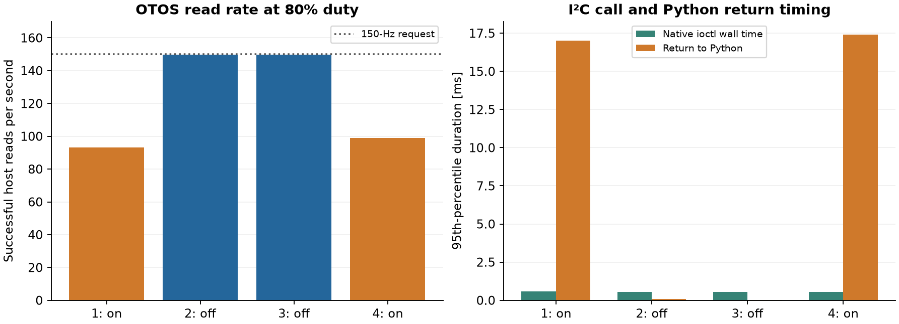
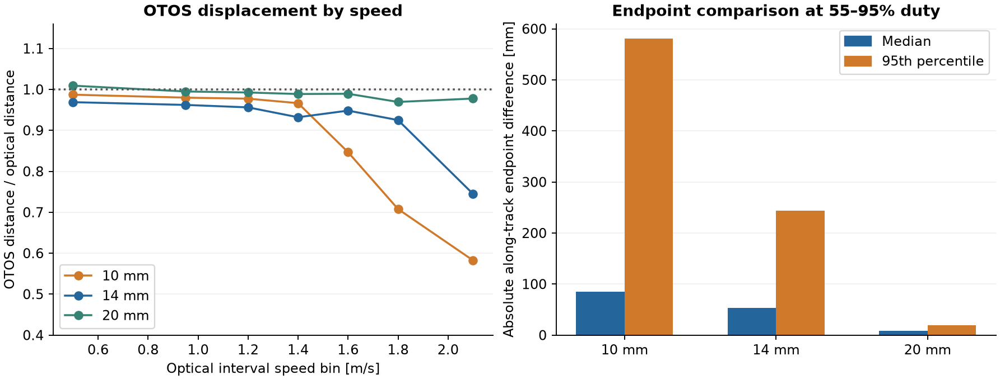
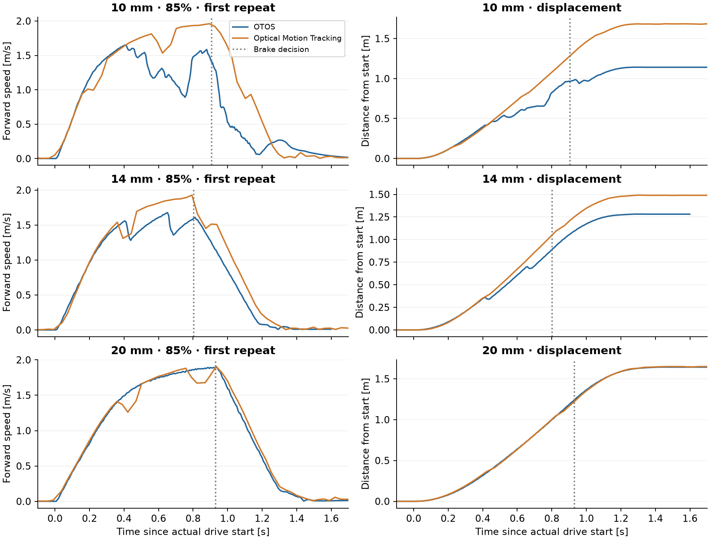

# OTOS testing

We use OTOS to get frequent motion updates between LiDAR scans. LiDAR then corrects the accumulated drift using the field walls. When we started driving faster, OTOS sometimes fell behind the motion measured by tracking. At first this looked like one problem, but we eventually found two. The program was sometimes reading the sensor too slowly, and the sensor could also miss movement even when we read it at the intended rate.

## Read rate

One detail that stood out was that some high-duty runs had fewer OTOS readings already during the early acceleration, before the robot was moving particularly fast. We tried stationary tests and duty sequences with the wheels lifted, then compared floor runs with encoder acquisition on and off. We measured the duration of the native I²C call separately from the time it took for Python to continue after that call returned.

We drove four legs at 80% duty, with encoder acquisition on, off, off and on again. With it on, we got about 93 and 99 OTOS reads per second. With it off, both runs stayed near 150 Hz. The I²C calls themselves remained short, with a 95th percentile around 0.54–0.58 ms. Instead, the delay before Python continued rose to about 17 ms when the encoder was enabled. The program also used approximately one full CPU core in those stages, compared with about 15% with encoder acquisition off.

We recorded roughly 16,000 encoder events per second, including many repeated-polarity transitions. Together with the timing measurements, this points to the event-processing load delaying the OTOS reader. We turned off GPIO acquisition, decoding, speed estimation and per-edge recording together, so this test doesn't tell us how much each part contributed. It also doesn't measure electrical noise on the bus. For that we would need a different measurement of the I²C signals. The [four-run comparison](../../tools/experiments/data/encoder-ab.json) includes the timing results and the protective stop on the last leg.

Based on this, we left encoder acquisition off for the mounting sweeps. That brought the OTOS reader back to its requested rate without first changing the bus hardware. We could then investigate the missed movement separately.

## Tracking at higher speeds

In the faster straight runs, the OTOS speed sometimes flattened or dropped while Optical Motion Tracking still showed the robot accelerating. Even when the reported speed recovered, the missed distance could remain in its position. We therefore compared the reported velocity, changes in position and stationary start-to-finish displacement, rather than looking at the speed curve alone.

The sensor's optical-tracking warning helped identify some of these cases, but didn't catch everything. In one later curve test, its position briefly moved backward while velocity still indicated forward motion. The status byte was 0x00. We needed consistency checks on the readings themselves as well as the status flags.

## Sensor orientation and replacement

We first tried rotating the sensor by 45°. The idea was to distribute straight-line movement across both sensor axes, instead of putting most of it on one axis. That could help if a per-axis limit was the main problem, but the test didn't give us a dependable improvement. The new mount also moved the window 1.9 mm forward and 39.9 mm left. It therefore observed a different strip of floor and had a different offset from the axle. We kept those changes in the [mounting record](../../tools/experiments/data/rotated-mount.json), since we couldn't attribute the result to orientation alone.

Next we tried the spare OTOS. Its straight-line measurements looked more promising, although we also had to correct the mounting direction in the software and repair the loose wheel mounting. We repeated the sweep after those corrections. With several changes involved, we couldn't conclude that the first sensor itself was defective. For the following height comparison, we used the replacement after the repair and kept its recorded position, orientation and unit scale factors the same.

## Mounting height

We made mounts for different distances between the sensor window and the floor. The height refers to the window itself, not the PCB. We tested 10, 14 and 20 mm in the standard orientation, without encoder acquisition or onboard video. For each height, we planned two measurements per duty value from 55 to 100%. The 14 mm set came from several interrupted and continued runs and includes three shortened 100% attempts, so it wasn't one uninterrupted twenty-leg sweep.

On the left, we compare how much distance OTOS recorded at different optically measured speeds. We stop these evaluation intervals at least 80 ms before the brake decision. Within each speed range we take one median per leg, then weight the legs equally. On the right, we compare the same 18 legs per height at 55–95% duty, leaving out the unequal shortened 100% attempts. Both plots use the unscaled readings. The data also includes the separate normalised analysis.

| Window height | Host read-rate range | Median / P95 absolute along-track endpoint difference, matched 18 legs | Legs with sustained severe motion loss, full analysed set |
| --- | --- | --- | --- |
| 10 mm | 149.0–151.0 Hz | 85 / 581 mm | 8 / 20 |
| 14 mm | 148.9–150.6 Hz | 53 / 244 mm | 2 / 21 |
| 20 mm | 149.5–150.8 Hz | 9 / 20 mm | 0 / 20 |

We recorded no I²C errors or writer faults in any of the three sets. To count a severe motion-loss episode, we required at least two adjacent overlapping intervals spanning 160 ms or more, with less than 80% of the optical movement captured after a low-speed gain correction. The condition had to hold for all three timing variants. This is our comparison rule, not a limit specified by the sensor manufacturer. At 10 mm, one episode occurred around an interval mean speed of 0.83 m/s. The failure therefore couldn't be explained by a single cutoff above 1.5 m/s.

These plots show the first 85% measurement at each height. The dotted line marks the brake decision, and the optical speed is calculated from the recorded positions. In the 14 mm measurement, the speed starts to recover after an earlier drop, but a distance error remains. We have included the stop in these plots so we can compare the final displacement as well. The powered-motion statistics above exclude that braking interval.

At 20 mm, the highest observed 150 ms speed window was near 2.10 m/s, with no episode meeting our powered-motion-loss rule. This was the best of the tested mounts, so we kept it for control development. We had only tested short straight legs, with different batteries and camera registrations between sessions. We also measured about 25 mm median lateral endpoint difference in the matched 20 mm legs. The 9 mm longitudinal result therefore doesn't describe the full position error, and the observed peak doesn't establish a reliable 2.10 m/s operating limit. The [height comparison data](../../tools/experiments/data/mounting-heights.json) includes both error components, repeat identities and stop reasons.
