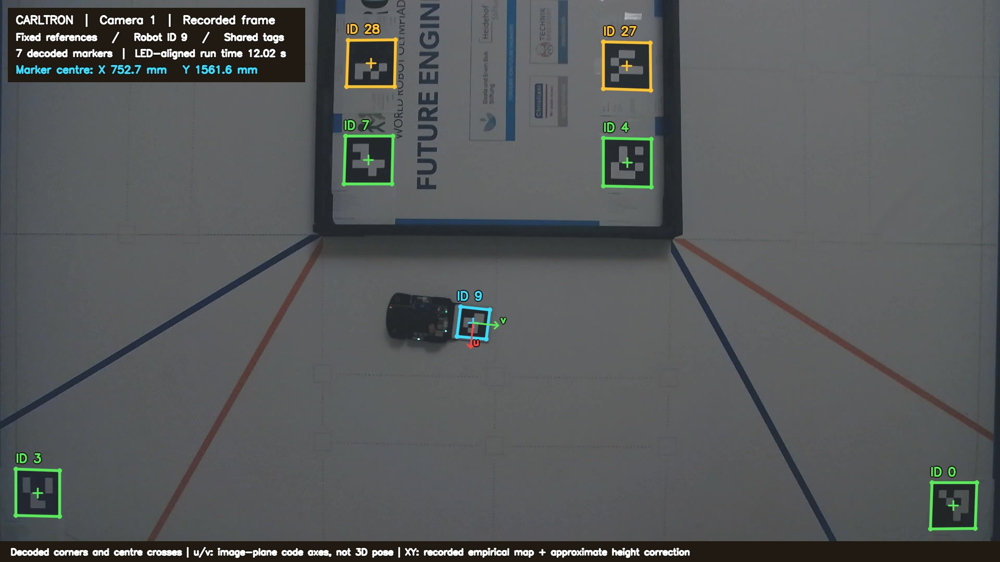
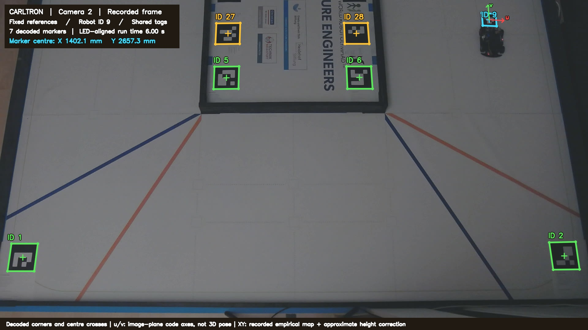

# Optical Motion Tracking

For the International Final, we want to drive faster while keeping the robot reliable. To work on that, we needed a better way to compare changes than checking whether a run finished. The robot's logs already showed OTOS movement, its calculated field position and drive commands. What we were missing was a separate measurement of where it had actually driven.

We built our Optical Motion Tracking system for this purpose. Two cameras observe fixed markers on the field and a rigid marker behind the robot. From their images, we calculate its position and heading on the development PC. In the first comparison described here, the robot drove using OTOS and the S3 LiDAR without receiving tracking positions. We later added an API for test setup, repositioning and safety checks, as described in the [test setup](../testing/measurement-system.md).

## Camera setup

We wanted to investigate errors of a few millimetres with equipment we could reasonably set up around the field. We first considered one camera above the whole field, but the available ceiling height limited how much it could see. We instead used two Logitech PTZ Pro 2 cameras we already had, capturing uncropped 1920 x 1080 images at a nominal 30 fps. In the first setup, each covered about half the field with an overlap between them. For later tests we changed one view to cover the whole field and registered the new arrangement separately.

The cameras sit at different heights and angles. We account for those differences by mapping each view to the field, so the mounts don't have to be identical or perfectly vertical. We keep the original recordings to be able to repeat the analysis after changing the software.

## Field geometry and markers

We use ArUco markers from OpenCV's `DICT_4X4_50` dictionary. Their encoded ID and orientation let us tell the field markers from the robot marker and identify their corners consistently. We use fixed IDs 0 to 7 to establish the field coordinates. The origin is the physical near-left inside-wall datum used to align ID0, with X pointing right and Y towards the far end in the original overview. IDs 27 and 28 are visible in the overlap, but we left them out of this registration.

Our mat consists of three joined strips. When measuring it, we found several longitudinal spans of 2990–2994 mm instead of the nominal 3000 mm. Using the PDF dimensions directly would have attributed some mat and placement errors to the robot. We therefore measured the installed reference positions, including the offsets of the inner markers, and used those in our field model.

On the robot we use ID9, with an 85 mm black square on a rigid 100 mm square plate. This leaves a 7.5 mm white border for detection while keeping the marker large enough in the image. Its centre is measured at 100.72 mm behind the rear axle midpoint and centred across the robot. The plate is about 4.5–5.3 mm above the floor. We record both the marker centre and rear axle position and apply an approximate correction for the marker's height.

## Marker detection

After decoding a marker, we refine its corners to subpixel coordinates. This gives us positions between pixel centres, although the final accuracy still depends on exposure, blur, lens calibration and the field references.

These are actual frames from the first paired driving recording, processed with the included detector:

Camera 1 at approximately 12.02 s. Green outlines mark the fixed references, cyan the robot and amber the shared tags. The crosses show projective centres. The u/v arrows follow the marker's coded directions in the image and don't represent a measured 3D pose.

Camera 2 at approximately 6.00 s, so it shows a different moment. XY is calculated with the saved mapping and approximate height correction. The [Camera 1](images/camera-1-detections.json) and [Camera 2](images/camera-2-detections.json) reports contain the decoded corners and original image hashes.

## Camera calibration

To convert image positions into field coordinates, we use a homography, which maps points from the camera view onto the field plane. We also fitted a radial model for lens distortion. We tried different numbers of radial terms and checked reference markers that weren't used in each fit. This helped us see whether an extra parameter improved the mapping beyond its training points.

If a camera moves, we can register its new view from the fixed markers. Changing zoom or focus needs an additional check of the lens model, since the old coefficients might no longer be suitable. We fit the spatial mapping only from stationary references. Using the robot's path or its own logs to fit that map would make the later comparison less useful.

We find the marker centre by intersecting its diagonals. Averaging the image corners would give a different point under perspective. All four mapped corners are then used to estimate heading and apply the marker-to-axle offset. For the height correction we use approximate mount measurements and a constant marker-centre height. The [usage guide](USAGE.md#recorded-geometry-and-reference-points) gives the assumptions, including the small tilt of the plate that isn't fully modelled here.

## Setup adjustments

We made several changes while getting the setup ready for useful comparisons:

| Observation | Change and consequence |
| --- | --- |
| Printed mat dimensions and inner-marker placements differed from the nominal map. | We measured the installed geometry and kept it separate from the PDF layout, so print and seam errors are not automatically attributed to the robot. |
| Motion blur, bright edges and occlusion affected the moving marker. | We added manual exposure controls and used a rigid plate with a clear surround. Detection still needs evaluation at the intended driving speeds. |
| Camera resets and realignment changed the image-to-field relationship. | We register the current view from fixed tags, keeping lens validation separate from pose registration. |
| The marker was above the floor, and its centre was not the robot's root point. | We lowered the mount and retained height and axle-offset corrections rather than comparing different physical points. |

The measurements below check the resulting setup. We didn't measure the accuracy improvement from each adjustment separately.

## Clock synchronisation

The cameras and robot don't share a clock. At 1 m/s, a 30 ms offset already creates 30 mm of apparent position error. For the first run, we used visible LED changes and their logged times to align the recordings without fitting the trajectories to each other. Camera 2 gave us 14 matched edges over 10 pulse cycles, but individual matches still varied by tens of milliseconds. The time an image arrives also isn't the time it was exposed.

We shifted the robot's centred map by (1500, 1500) mm into the field-corner coordinates, without fitting this to the tracked path. We then looked separately at known stationary placements, repeatability and the position differences during motion.

## First measurements

At a known marker-centre placement of (1550, 650) mm, which was not used to fit or select the mapping, we obtained:

| Measurement | Result |
| --- | --- |
| Camera 1 error in X and Y | +1.77 mm, -0.08 mm |
| Camera 2 error in X and Y | +0.79 mm, -0.46 mm |
| Distance between camera estimates | 1.06 mm |
| Approximate reference-placement uncertainty | 1.5 mm |

At this position, the cameras agreed to about one millimetre, with errors similar to the uncertainty of placing the marker. This was encouraging, but we had only checked one position. It didn't establish the accuracy over the whole field or while driving.

For the first drive, we compared the stationary start and finish positions. The displacement from fused localisation differed from the camera result by about 6.4 mm, compared with 145.9 mm for OTOS alone. We used a start window after position initialisation and before the first drive command. An earlier window that included initialisation had to be rejected. Different cameras saw the two endpoints, so their registration also contributes to the comparison error.

While moving, the median difference between camera and fused positions was much larger, at about 66–90 mm across the views. Much of it was along the direction of travel, which is consistent with a timing error. There were also lateral differences, so we couldn't explain everything with a clock offset.

The [result data](../../tools/tracking/examples/first-run/results.json) contains the stationary placement and displacement comparisons. They gave us a useful way to compare drift after a drive. For measurements during fast motion, we still had to improve the timing and understand the remaining spatial errors before making millimetre-accuracy claims.

## Software and setup

The [usage guide](USAGE.md) covers installation, recording, geometry and analysis. The [tools](../../tools/tracking/) include camera controls, offline detection, registration, height correction and a local replay viewer. `render_marker_frame.py` reproduces the illustrated detections from saved images without opening a camera.

The [robot target PDF](markers/Carltron-Robot-Marker-ID9-100mm-A4.pdf) has the 85 mm version on page 1. The [field reference pack](markers/Carltron-Side-View-Tracking-Pack-A4-v3.pdf) provides alignment guides and calibration boards. Its [nominal coordinates](markers/Carltron-Side-View-Tracking-Coordinates-v3.json) differ from our [measured field example](../../tools/tracking/profiles/measured-field-example.json). Print at actual size and verify dimensions.

The full recordings stay outside Git. The [compact example](../../tools/tracking/examples/first-run/) contains selected original images and analysed traces, with gaps where detections were missing. The viewer also accepts full local archives.

The later [sensor and drivetrain tests](../testing/README.md) describe how we extended the recordings and API and used them for faster driving. The results on this page belong to the first setup and haven't been recalculated as a calibration of the later camera arrangements.

