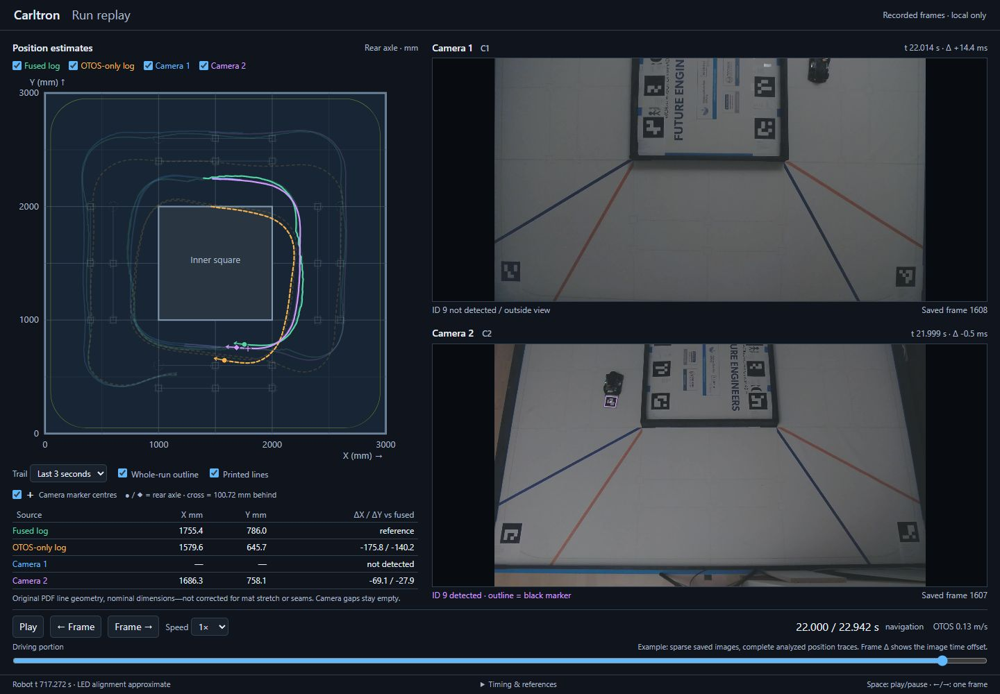

# Optical Motion Tracking setup

The [optical motion tracking overview](README.md) explains the system design, measurement method and initial validation results. This page contains the installation, recording and analysis commands.

## PC installation

Python 3.12 is the version used for these experiments. The replay itself uses only the Python standard library. Detection and camera preview have separate dependencies from the robot's runtime.

From the repository root on Windows:

```powershell
python -m venv .venv-tracking
.\.venv-tracking\Scripts\Activate.ps1
python -m pip install -r tools/tracking/requirements.txt
```

This uses `opencv-contrib-python-headless` for marker detection without a desktop image window, and `imageio-ffmpeg` for the video tools. Keep this environment separate from the robot's environment and from installations containing another OpenCV wheel. We tested these tools with OpenCV 4.13.0, NumPy 2.3.5 and imageio-ffmpeg 0.6.0.

Offline analysis and the replay do not need a connected camera. The camera controller needs Windows, Windows PowerShell and the installed camera driver. It uses Windows camera interfaces rather than a Logitech-specific SDK. A Linux port of that controller is not included.

## Camera controls and recording

Start the controller from the repository root:

```powershell
.\tools\tracking\camera-control\Start-Camera-Control.ps1
```

It opens Microsoft Edge at `http://127.0.0.1:8765`. The camera selector connects the preview and controls to the same physical device path. The order can change after USB reconnection, so it isn't enough to identify a camera. Rediscover refreshes the list without deliberately restoring settings or moving the cameras.

For a measurement, we set the framing, zoom and focus, then leave them fixed during the recording. Exposure is kept short enough to retain marker edges while still giving a usable image. More light is preferable to compensating with excessive gain or brightness. Read-back of an exposure control is not proof of the actual exposure time of every frame.

The normal web preview is displayed at 15 fps while native capture is nominally 30 fps. It is a framing aid, not the measurement recording. The controller's usage file explains the image controls, bounded pan/tilt pulses, presets and programmatic access. Logical PTZ feedback does not establish a mechanically repeatable camera position.

We keep both capture streams open between measurements because closing and reopening them can cause standby or driver resets. To capture simultaneously, we also had to separate the cameras across USB connections. After a reset, we check the framing and settings again. The tools below work on saved clips. The persistent paired-capture service used locally isn't included here.

For each recording we retain the original images, camera identities, optical settings, frame timing information, fixed-marker geometry, mounting assumptions and matching robot logs. We do not replace a missing detection with a predicted position and then label it as a measurement.

## Tracking a saved clip

`track_robot_marker_video.py` processes an uncropped 16:9 clip. It decodes markers on every frame, retries missed targets using wider threshold settings and local contrast, and records ambiguous detections. The moving ID9 never participates in fitting the field map.

This example command uses our measured field layout. A different field needs its own coordinates:

```powershell
python tools/tracking/track_robot_marker_video.py all --video "recordings/camera-2.mp4" --output "output/tracking/clip-review" --geometry tools/tracking/profiles/measured-field-example.json
```

The clip must show at least four fixed primary markers often enough to collect 30 detections of each. The current clip model is an empirical floor-plane homography with two radial terms, chosen before evaluating the moving marker. The report also compares zero- and one-radial-term models and performs leave-one-tag-out checks. Strong disagreement between those models is a reason to investigate calibration, not evidence that a target moved.

The stages can be run separately by replacing `all` with `detect`, `analyse` or `render`. Use a new output directory for a new detection run. Important outputs are:

| File | Meaning |
| --- | --- |
| `detections.jsonl` | Decoded IDs and image corners for every frame |
| `analysis-summary.json` | Mapping, fixed-reference checks, detection counts and assumptions |
| `id9-track.jsonl` | Marker-centre coordinates or an explicit missing detection |
| `id9-speed.jsonl` | Current speed fit, or the age of the last valid fit |
| `output-verification.json` | Frame and presentation-timestamp checks for the overlay video |

The MP4 overlay uses the video's presentation timestamps, which aren't independently measured exposure times. Its decorative cube is an illustration and doesn't measure Z. The single-clip XY output projects onto the floor without correcting for marker height. The mounted-robot comparison uses the separate geometry functions below.

Speed is a backward least-squares fit over a 0.15 s window of detected centres. A gap above 0.075 s or an implausible marker shape resets the current fit. During a dropout the overlay can show the last measured speed with its age, but not a newly measured current speed.

## Annotating a saved frame

For a detection-only image, use:

```powershell
python tools/tracking/render_marker_frame.py --image "recordings/frame.jpg" --output "output/tracking/frame-detections.jpg" --camera 1
```

The image shows every uniquely decoded marker, its corners, centre and ID. Duplicate IDs are reported as ambiguous instead of accepted as measurements. The u/v arrows on ID9 follow its coded image directions and don't show a calibrated 3D pose.

Optional `--mappings` and `--mounts` arguments enable marker-centre XY for that exact recorded view. Both are required together. The mappings in `profiles/` belong to the saved October 5 views and won't apply to arbitrary new images. `--time-seconds` labels a known run time, since the program can't determine clock alignment from one frame. A JSON report beside the image records decoded corners, image hashes and the assumptions used for its coordinates.

## Registering a changed view

`adapt_run_registration.py` refits the floor homography from stationary field tags while keeping the existing lens coefficients fixed. It needs three well-spread fixed tags. With four or more, it can also check each tag against a fit made without that tag. Only IDs 0 to 7 are used, excluding the robot, shared tags and robot trajectory from the registration.

Its input folder contains `camera-1-preliminary-sampled-detections.json` and the corresponding camera-2 file. Each is a JSON array with `corners_px` dictionaries keyed by decoded ID and an `ambiguous_ids` list. Coordinates must refer to the uncropped 1920 x 1080 image. The initial maps are a JSON object with a `views` array, as in our recorded example:

```powershell
python tools/tracking/adapt_run_registration.py output/tracking/new-run --lens-file tools/tracking/profiles/recorded-run-mappings.json --geometry tools/tracking/profiles/measured-field-example.json
```

This writes `registered-run-mappings.json` without overwriting an existing result. It reports the errors on withheld fixed tags as well as those used for fitting. A new registration can account for a moved camera, but changing zoom or focus may also change the lens model. We check those settings with known placements that weren't used to fit the map, since a small fitting error alone wouldn't confirm that the old lens coefficients still work.

The `pose_from_quad` function maps all four corners, intersects the diagonals for the centre, and estimates orientation from all corners. An arithmetic average of four perspective-projected image corners is not generally the projected marker centre.

For a raised marker, `height_geometry.py` uses:

```text
p = C + (H - h) / H * (q - C)
```

Here q is the camera ray's intersection with the floor, C is the point directly below the lens, H is camera height and h is target height. This corrects the ideal geometric parallax, while errors in the floor map and approximate mount measurements remain. For the first run we used a constant centre height instead of modelling the complete tilted plate.

## Recorded geometry and reference points

These assumptions describe our saved first-run analysis, not a calibration for an arbitrary new setup. The [mount file](../../tools/tracking/profiles/camera-mounts-example.json) records approximate camera positions:

| Camera | Height above field | Point directly below lens, X/Y |
| --- | --- | --- |
| 1 | 1720 mm | (800, 1500) mm |
| 2 | 3000 mm | (3050, 1500) mm |

The second camera's X assumes the nominal 3000 mm inside-field width plus approximately 50 mm of blue border. The mat edge and optical centres have not been surveyed. These coordinates are used for approximate height correction, not to fit the floor homography.

The [robot marker profile](../../tools/tracking/profiles/robot-marker-85mm.json) defines the printed 85 mm black square on a 100 mm plate. The mounting offset is measured separately. For the first-run comparison, its centre was 100.72 mm behind the rear axle midpoint with no reported lateral offset. The near plate edge is about 4.5 mm above the floor and the far edge about 5.0–5.3 mm. We used 4.825 mm as a constant centre height. A visually established -90 degree offset converts the coded marker orientation into the robot's forward direction. This wasn't an independently surveyed heading calibration.

For each detected pose, we preserve both the marker centre and the rear axle midpoint. Apply the offset in the estimated heading direction, not as a fixed global X/Y displacement. Marker height, heading and camera-mount uncertainty therefore also affect the axle estimate. The current implementation does not fit a complete tilted-plate model.

The [nominal coordinate file](markers/Carltron-Side-View-Tracking-Coordinates-v3.json) describes the printed alignment pack. The [measured field profile](../../tools/tracking/profiles/measured-field-example.json) describes our installed fixed references. Do not substitute one for the other or treat printed field features as exact nominal coordinates on the stitched mat.

## Comparing the run with robot logs

The two PC cameras and the robot do not share an exposure clock. For the first run, we estimated their clock relationship from recorded LED changes and robot LED event logs. The front LED changed at startup, while repeated rear LED pulses supplied more comparisons. Camera 2 had 14 matched edges over 10 pulse cycles. Per-edge scatter remained in the tens of milliseconds.

We did not choose a time offset or spatial transformation to make the camera trajectory agree with the robot. Robot log positions were shifted by (1500, 1500) mm from their assumed centred map into the field-corner frame. A different robot map needs an explicitly documented transformation.

Timing matters even when stationary results look good: at 1 m/s, a 30 ms timing error corresponds to 30 mm of travel. We therefore separate static placement error, stationary repeatability and moving disagreement.

## Replaying the included example

The repository includes the analyzed position traces from the first paired run and ten original JPEG keyframes. Large raw recordings are not included. The image manifest preserves source frame indexes and JPEG hashes.

```powershell
python tools/tracking/run-replay/server.py
```

Open `http://127.0.0.1:8770`. The slider, play button and arrow keys compare fused localization, OTOS-only localization and the two external camera estimates. Circles and diamonds represent the rear axle. Matching crosses show the marker centre, 100.72 mm behind it. Missing camera observations leave gaps.



The example has sparse saved images, so a displayed frame can be seconds away from the selected time. Each panel shows its actual time and delta. The trails retain all analysed observations, while the current camera symbol belongs to the displayed keyframe. The example therefore doesn't provide a full synchronised video replay.

A complete local archive can instead be selected with `--run PATH`. It needs the two `.mjpeg` files and receipt indexes, `camera-N-moving-observations.json`, `observed-led-timing.json`, `capture-manifest.json`, and `robot-logs/selected-drive-telemetry.json`. The original JPEG bytes are served by byte offset without re-encoding. The normal measurement viewer uses the full archive.

The field background represents nominal PDF line positions. It is not corrected for stretching or seams in the mat, and it is not used to calibrate camera positions. Blue and orange corner lines are omitted from the map.

## Offline checks

```powershell
python -m unittest discover -s tools/tracking -p "test_*.py"
python -m unittest discover -s tools/tracking/camera-control -p "test_server.py"
node tools/tracking/run-replay/test_math.cjs
python tools/check_repository.py
```

These checks do not open cameras or command the robot. They cover projective centres, radial mapping, the rotating marker-to-axle offset, exclusion of moving targets from registration, missing detections and replay frame identity. They are software checks, separate from physical camera validation.
