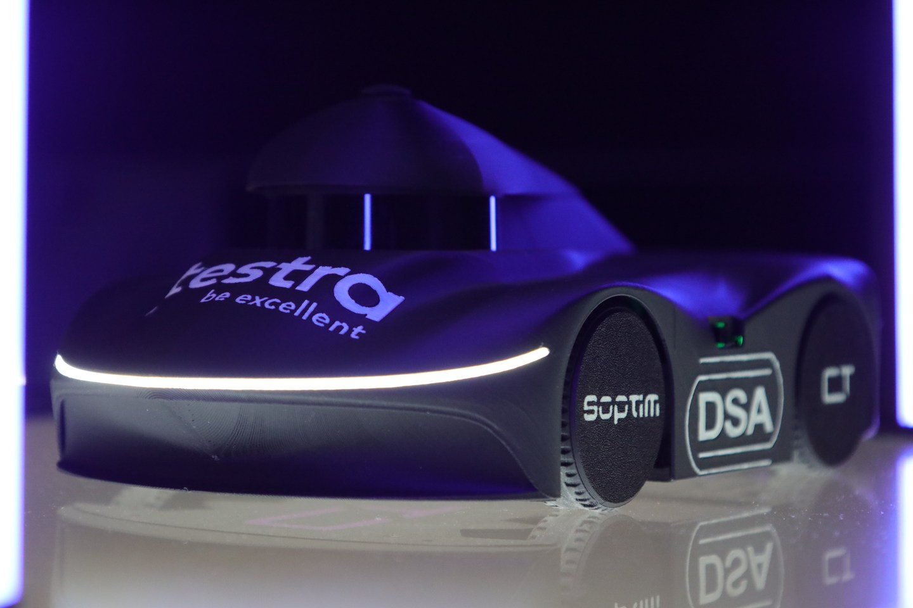
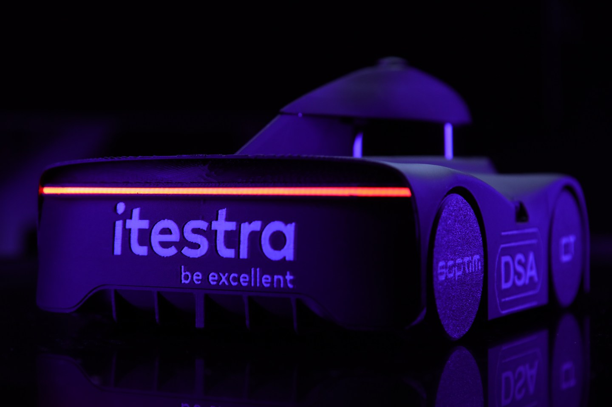
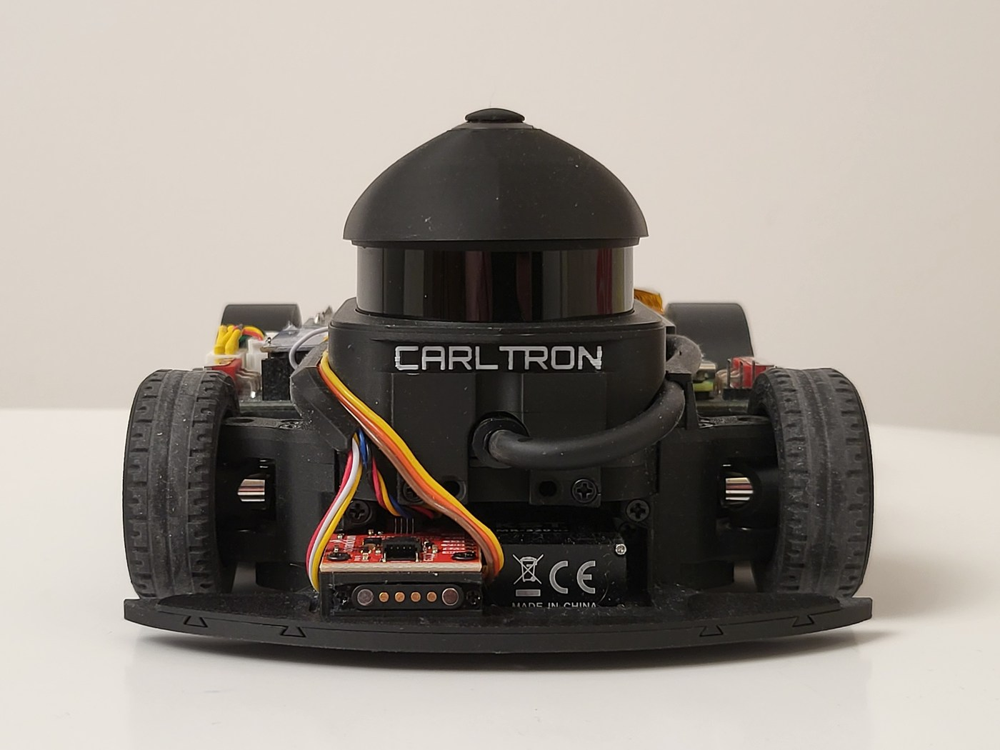
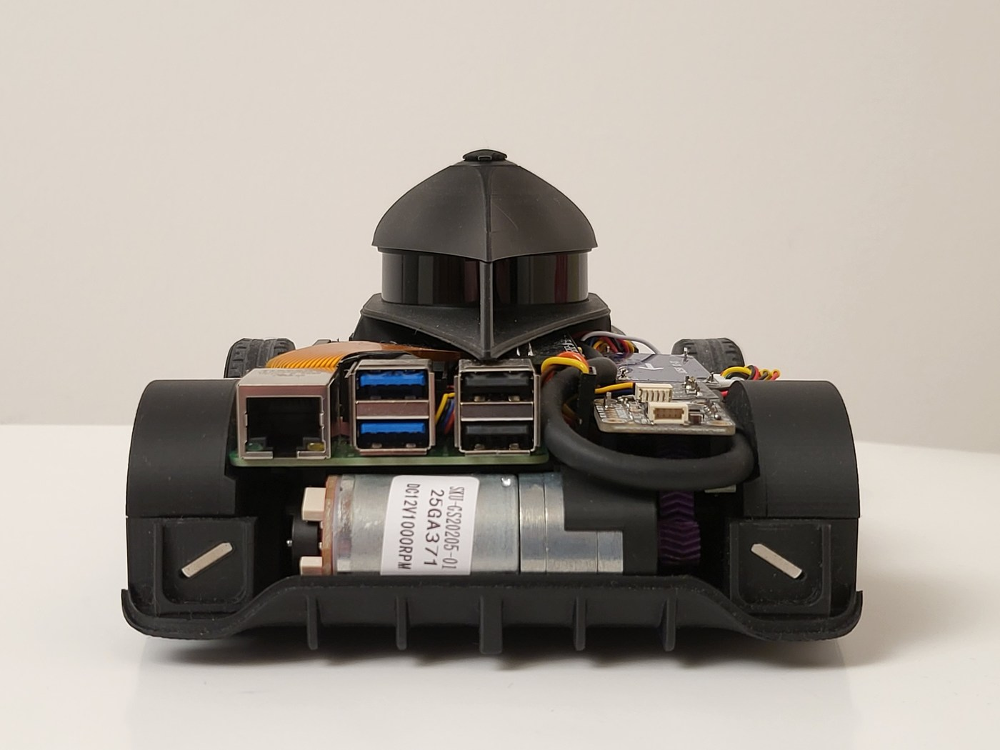
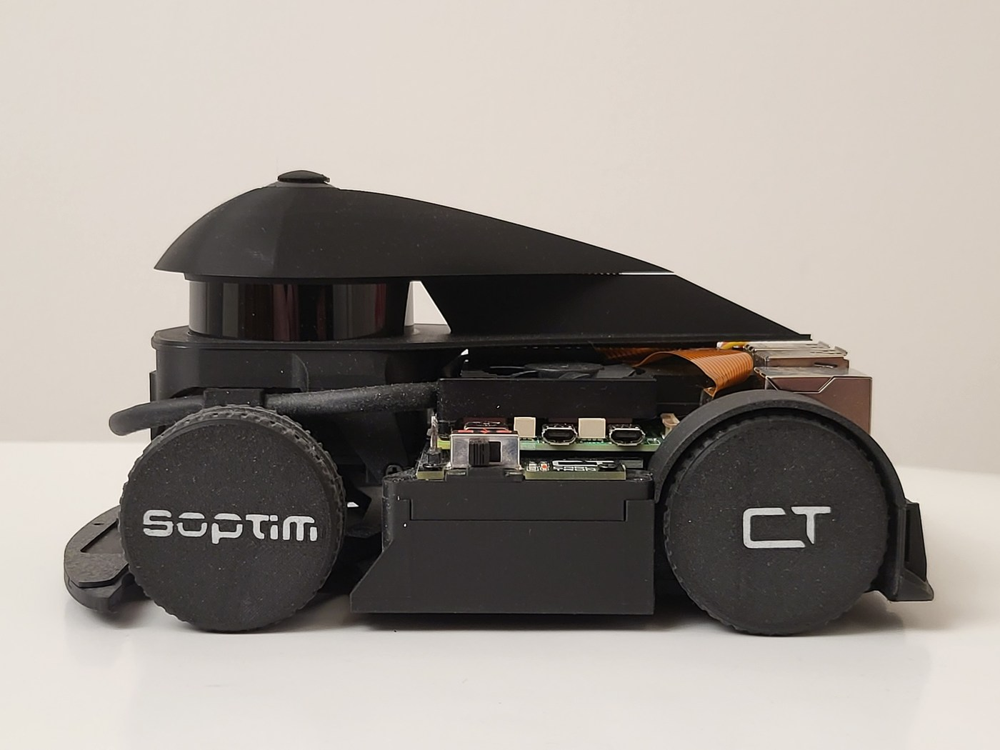
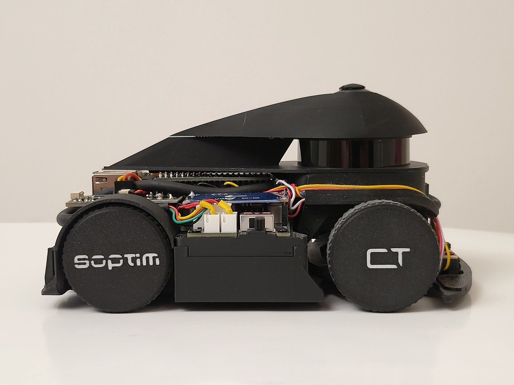
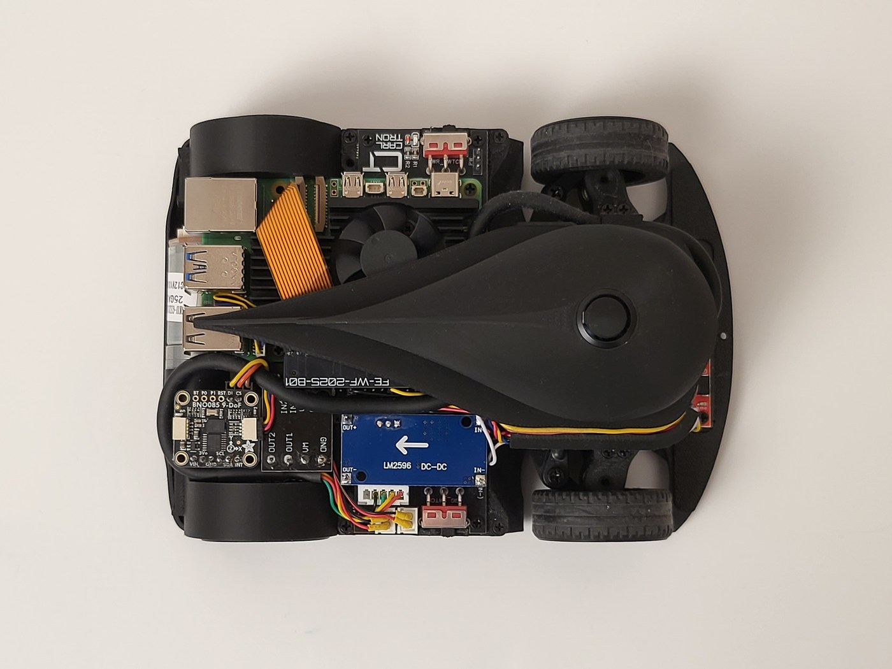
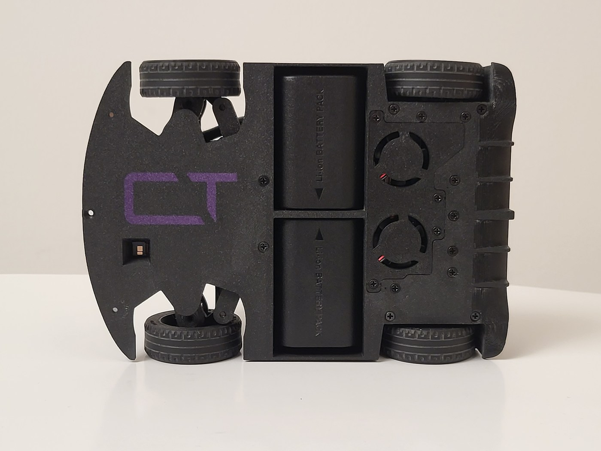

# Vehicle photographs

## International bodywork

| Front three-quarter view | Rear three-quarter view |
| --- | --- |
|  |  |

## Chassis views

These six views show the chassis described in the [hardware baseline](../docs/hardware.md). We removed the outer shell to expose the sensors, drivetrain and electronics. The LiDAR cover and the upward-facing camera stay on the chassis. The [annotated views](details.md) identify the components and switches.

| Front | Rear |
| --- | --- |
|  |  |

| Left | Right |
| --- | --- |
|  |  |

| Top | Bottom |
| --- | --- |
|  |  |
