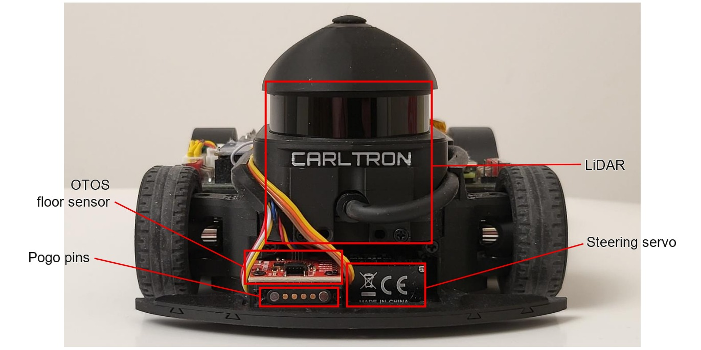
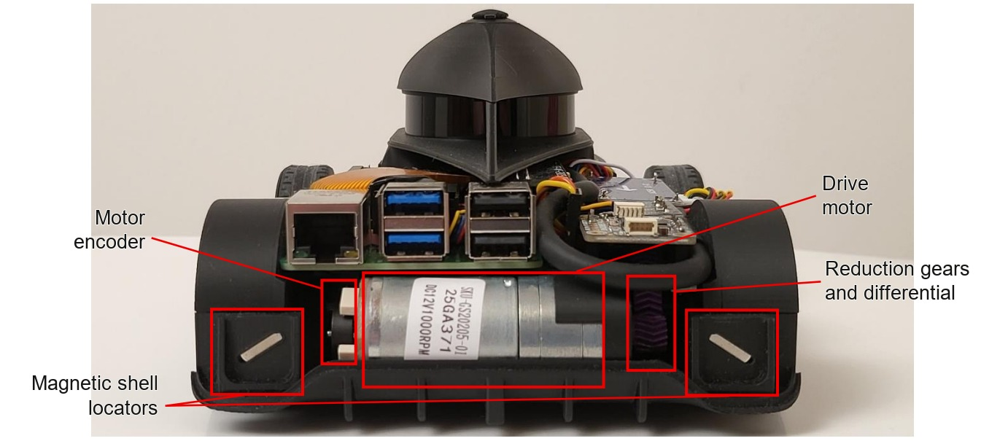
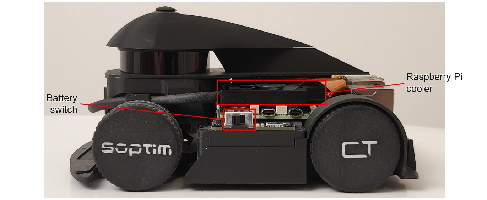
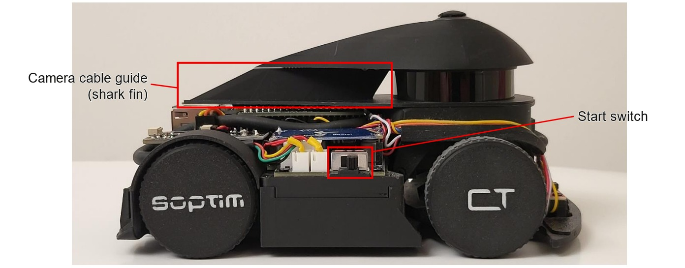
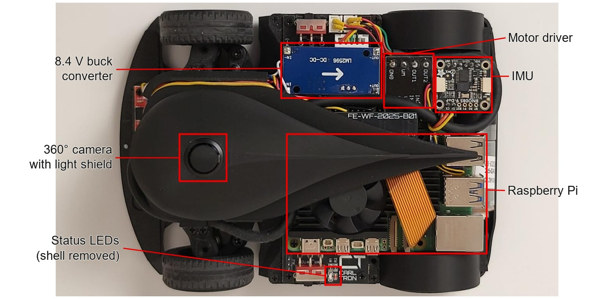
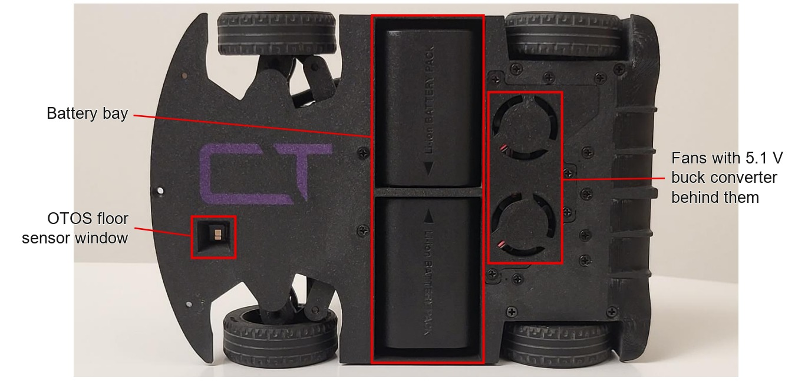

# Chassis details

These views identify the components of the [hardware baseline](../docs/hardware.md). The [vehicle gallery](README.md) contains the unmarked photographs.

## Front

## Rear

## Left

## Right

## Top

## Bottom

